# Sơ đồ kiến trúc và luồng hoạt động

Ngày lập: 28/10/2026 · Áp dụng cho nhánh `level3-cloud` (commit `c228d5cd`). Sơ đồ viết bằng Mermaid; GitHub hiển thị trực tiếp, VS Code cần extension xem trước Mermaid. Chi tiết giao thức xem [DEVICE_CONTRACT](DEVICE_CONTRACT.md); lịch sử thay đổi xem [CHANGES_SINCE_575489b9](CHANGES_SINCE_575489b9.md).

Mục lục:

1. [Kiến trúc tổng thể IoT Level 3](#1-kiến-trúc-tổng-thể-iot-level-3)
2. [Trước và sau nâng cấp](#2-trước-và-sau-nâng-cấp)
3. [Triển khai trên AWS](#3-triển-khai-trên-aws)
4. [Thành phần bên trong Core](#4-thành-phần-bên-trong-core)
5. [Luồng mở cửa bằng khuôn mặt](#5-luồng-mở-cửa-bằng-khuôn-mặt)
6. [Luồng mở cửa bằng PIN keypad](#6-luồng-mở-cửa-bằng-pin-keypad)
7. [Luồng admin mở cửa từ xa](#7-luồng-admin-mở-cửa-từ-xa)
8. [Vòng đời lệnh (command)](#8-vòng-đời-lệnh-command)
9. [Firmware xử lý lệnh và chống phát lại](#9-firmware-xử-lý-lệnh-và-chống-phát-lại)
10. [Luồng lockdown khẩn cấp và đồng bộ lại](#10-luồng-lockdown-khẩn-cấp-và-đồng-bộ-lại)
11. [Luồng camera trực tiếp](#11-luồng-camera-trực-tiếp)
12. [Vòng lặp firmware: PIR, cảnh báo kẻ lạ](#12-vòng-lặp-firmware-pir-cảnh-báo-kẻ-lạ)
13. [Kết nối thiết bị: Wi-Fi, NTP, WebSocket](#13-kết-nối-thiết-bị-wi-fi-ntp-websocket)
14. [Đăng ký khuôn mặt](#14-đăng-ký-khuôn-mặt)

---

## 1. Kiến trúc tổng thể IoT Level 3

Một nút local (ESP32-S3) thu dữ liệu và chấp hành; lưu trữ, phân tích và ứng dụng nằm trên cloud. Ánh xạ thành phần theo tài liệu môn học ở cột chú thích.

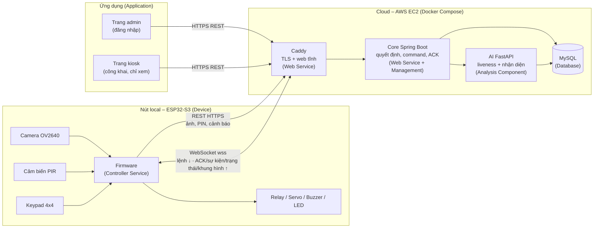

Điểm chính:

- Thiết bị chỉ nói chuyện với **một tên miền** (`smartlock-hung.duckdns.org`, cổng 443), xác thực bằng token Bearer.
- DB và AI **không** mở ra internet; chỉ Core gọi được.
- Trình duyệt không có đường mở cửa bằng ảnh/PIN; chỉ admin đã đăng nhập mở từ xa.

## 2. Trước và sau nâng cấp

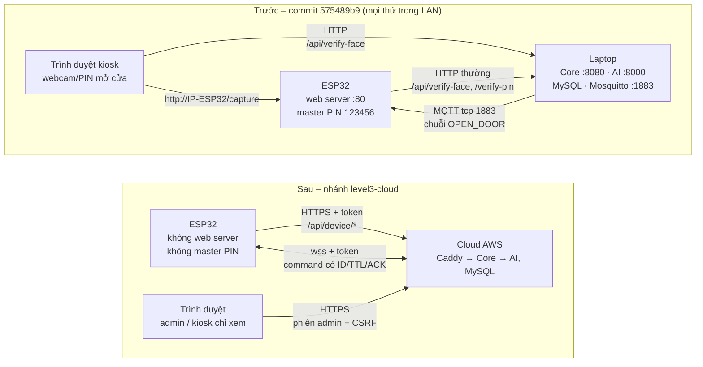

## 3. Triển khai trên AWS

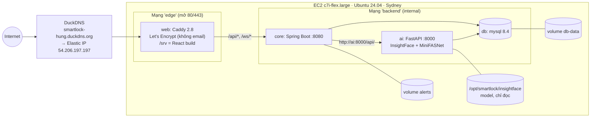

Bí mật (`.env`: mật khẩu DB, hash token thiết bị, admin ban đầu) chỉ nằm trên VM với quyền `600`, không có trong Git.

## 4. Thành phần bên trong Core

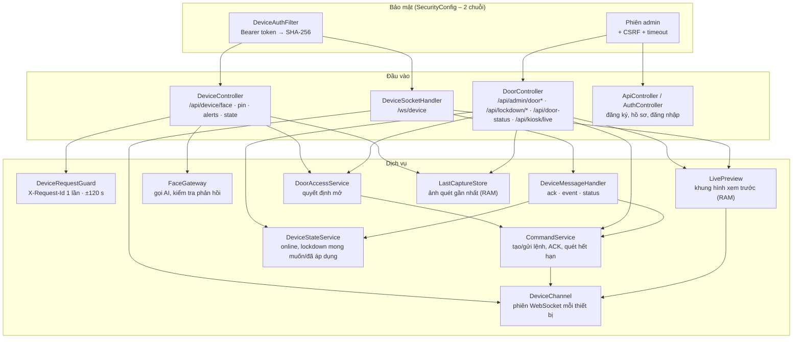

## 5. Luồng mở cửa bằng khuôn mặt

Chỉ ảnh từ ESP32 đã xác thực mới tạo được lệnh mở (D02). AI không có quyền mở cửa: Core luôn kiểm tra lại hồ sơ.

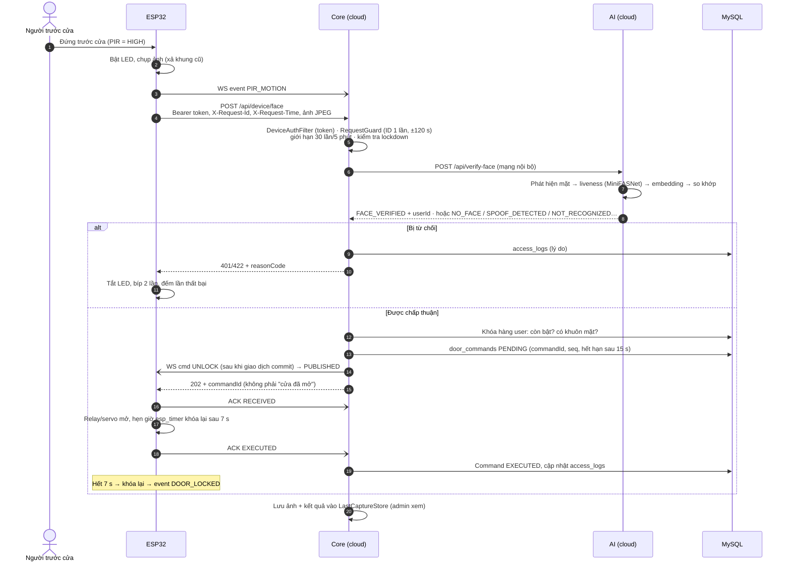

## 6. Luồng mở cửa bằng PIN keypad

PIN chỉ nhập trên keypad, không kèm mã hồ sơ (D04). Không còn master PIN.

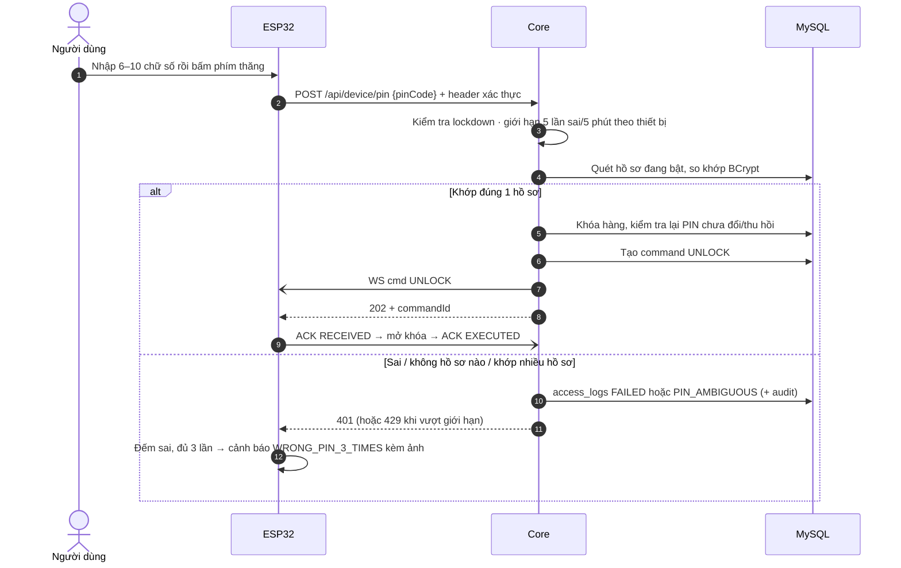

## 7. Luồng admin mở cửa từ xa

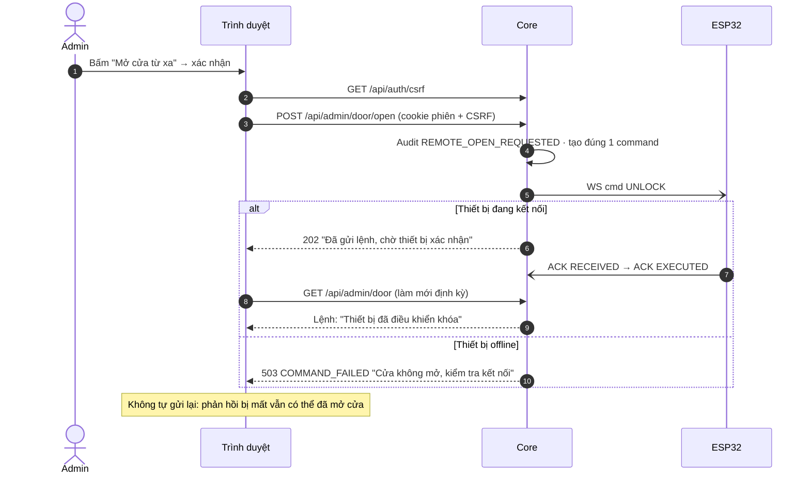

## 8. Vòng đời lệnh (command)

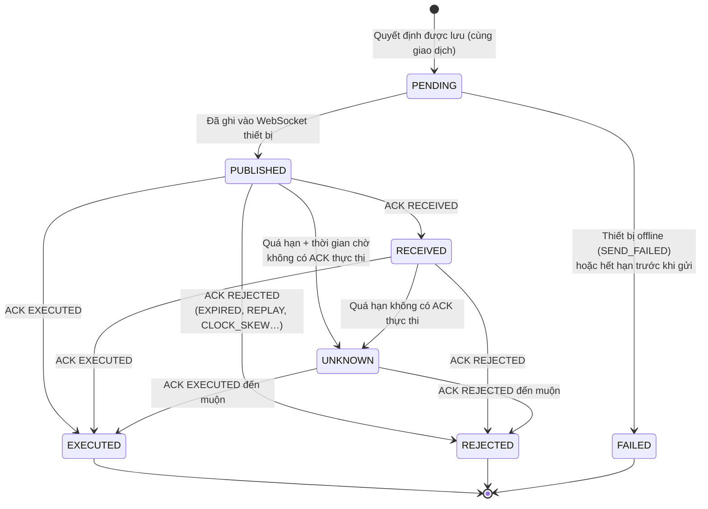

- Mọi chuyển trạng thái là compare-and-set; lệnh hết hạn **không bao giờ gửi lại**.
- `EXECUTED` = thiết bị đã điều khiển relay/servo, **không** phải cảm biến xác nhận cửa mở.

## 9. Firmware xử lý lệnh và chống phát lại

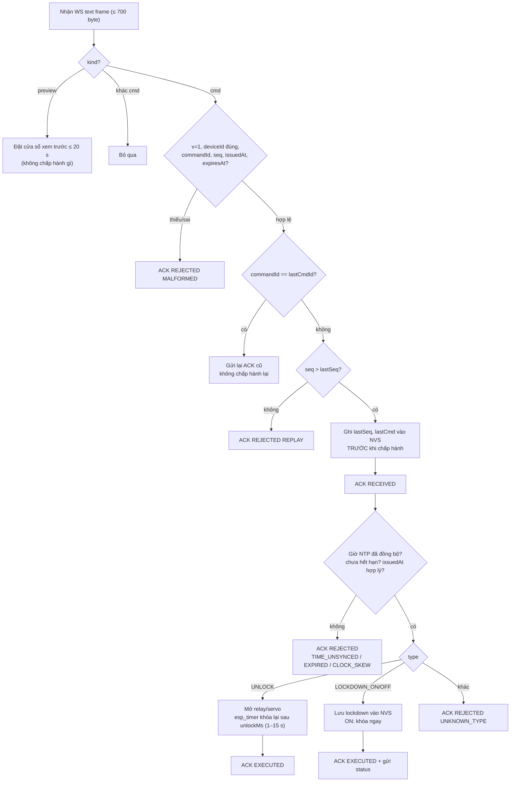

## 10. Luồng lockdown khẩn cấp và đồng bộ lại

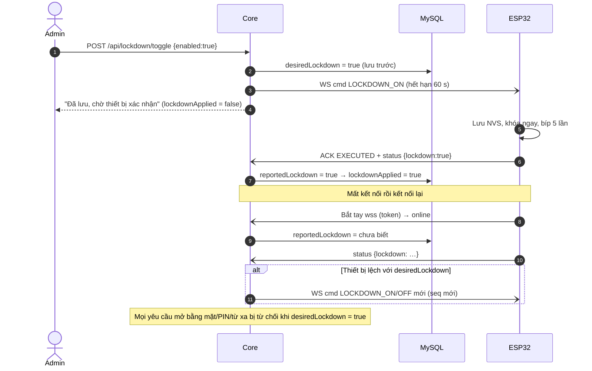

## 11. Luồng camera trực tiếp

Khung hình xem trước **chỉ để hiển thị**: không gửi tới AI, không tạo lệnh. Kiosk xem công khai theo D11; trang admin cần đăng nhập.

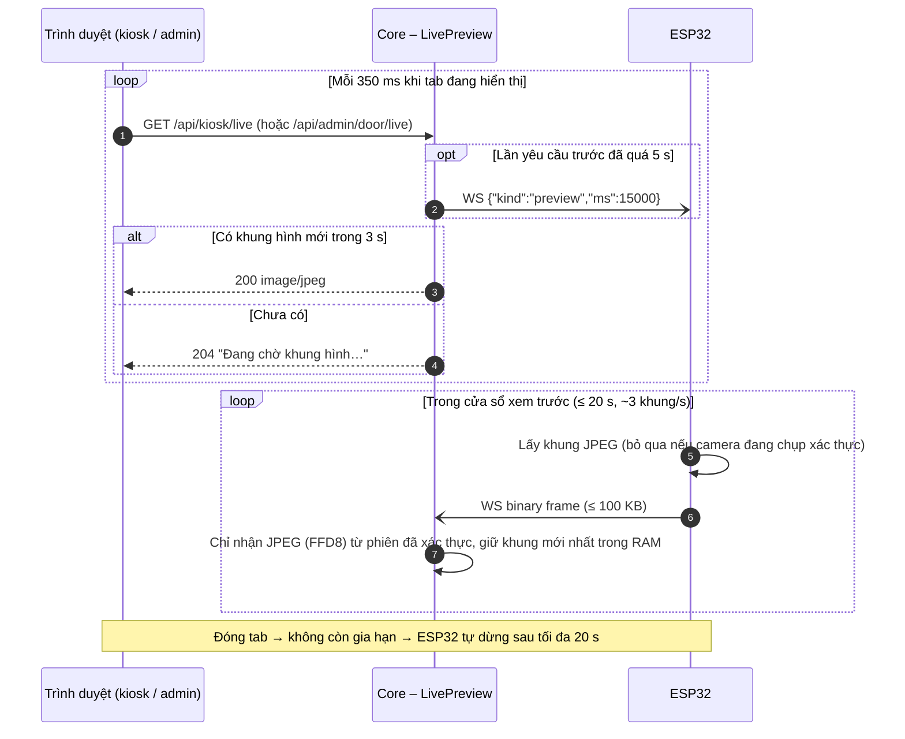

## 12. Vòng lặp firmware: PIR, cảnh báo kẻ lạ

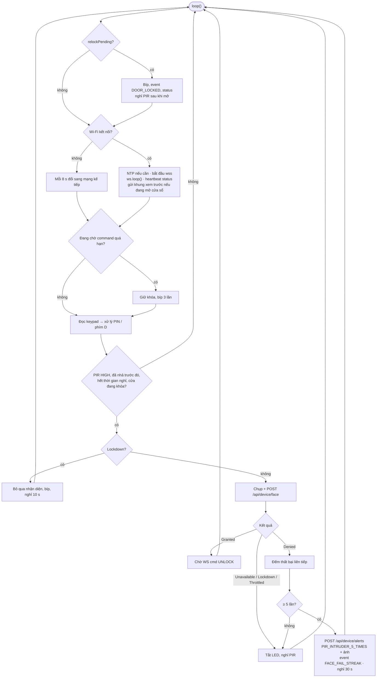

## 13. Kết nối thiết bị: Wi-Fi, NTP, WebSocket

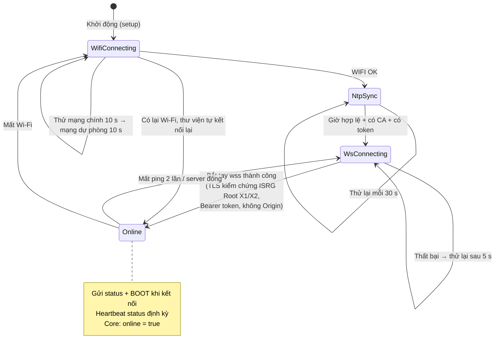

## 14. Đăng ký khuôn mặt

Webcam laptop chỉ dùng ở bước này (admin đã đăng nhập), không bao giờ là nguồn ảnh mở cửa.

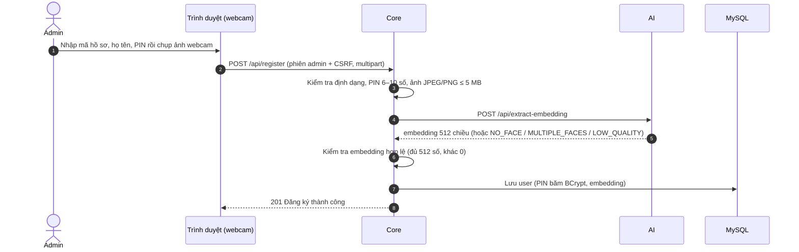
